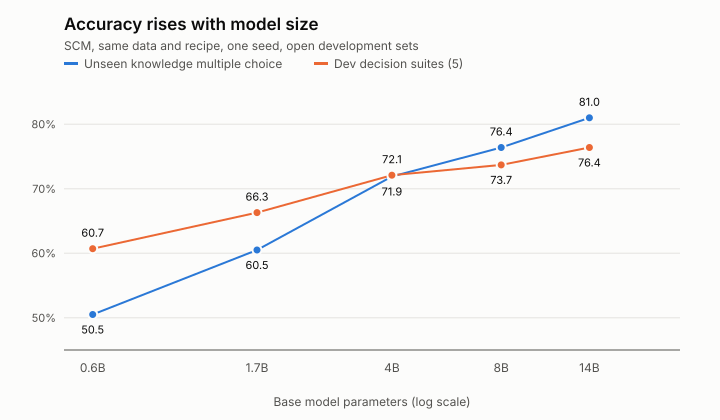
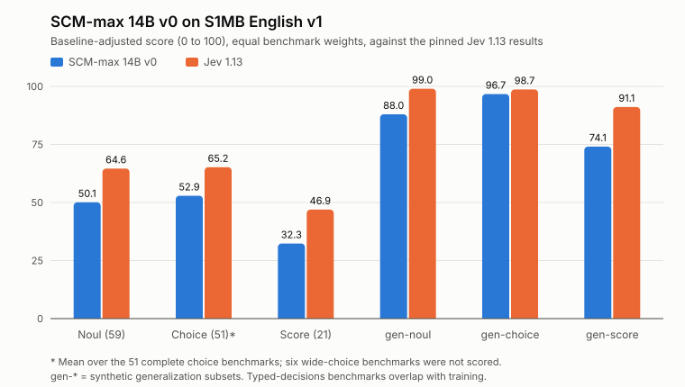

# Results

All numbers are **single-seed** results on open development data selected by us, not independent benchmark results, except the S1MB section which is an external benchmark. "Unseen" means a workflow family absent from the training pool.

## Size ladder (same data and recipe family)
| Model | Unseen knowledge multiple choice | Dev decision suites (5) | Security triage accuracy | Security triage balanced accuracy | CVE severity and KEV check |
|---|---|---|---|---|---|
| 0.6B (context) | 50.5 | 60.7 | 50.6 | 32.8 | 46.6 |
| **scm-min-1.7b-v0** | 60.5 | 66.3 | 57.0 | 40.4 | 50.5 |
| **scm-mid-4b-v0** | 71.9 | 72.1 | 57.8 | 35.9 | 42.5 |
| 8B (context, not released) | 76.4 | 73.7 | 60.4 | 43.0 | 55.3 |
| **scm-max-14b-v0** | **81.0** | **76.4** | 64.5 | **54.0** | **59.8** |

- Each doubling from 4B adds about 4.5 points on unseen knowledge multiple choice.
- On security triage the majority answer ("open an investigation") scores 71.3, so plain accuracy there is a weak yardstick; use the balanced figure. All joint-option models are weak on that suite.
- The 14B model met our two main development thresholds and missed the security-triage threshold by 0.6 points, so under our own pre-registered rule none of the sizes is a "kept candidate". The adapters are published as open experimental releases.
- 0.6B and 8B adapters are not on the Hub.

## S1MB English v1 (scm-max-14b-v0)

131 of 137 benchmarks complete; the six wide-choice benchmarks (more than 20 options) fail by design. Scores are baseline-adjusted (0 to 100) against the pinned Jev 1.13 results; SCM-max is clearly below it, and its three typed-decisions benchmarks are inflated by training overlap. Details and the full disclosure: [S1MB submission](s1mb-submission.md).

| | Noul | Choice (51 of 57) | Score | gen-noul | gen-choice | gen-score |
|---|---|---|---|---|---|---|
| scm-max-14b-v0 | 50.09 | 52.9 | 32.31 | 88.00 | 96.71 | 74.07 |
| Jev 1.13 | 64.63 | 65.2 | 46.92 | 99.00 | 98.68 | 91.14 |
