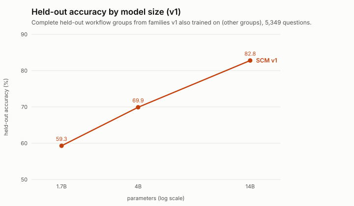
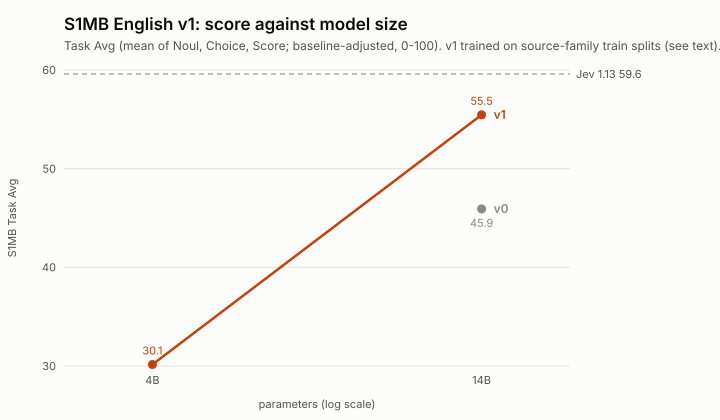

# Results

Held-out numbers are single runs on workflow groups that our training data does not contain but whose families it does (see [how v1 was built and checked](v1.md)); they are not independent benchmark results. The S1MB section is an external benchmark.

## Held-out accuracy by size
| Model | Held-out accuracy | Released |
|---|---|---|
| scm-mid-4b-v1 | 69.9 | yes |
| scm-max-14b-v1 | **82.8** | yes |
| 1.7B v1 | 59.3 | no (did not pass the release check) |

5,349 held-out questions from complete workflow groups. Because these groups come from families the model also trained on (other groups), they favour v1; they say little about workflows unlike the training data.

## S1MB English v1 (scm-max-14b-v1, scm-mid-4b-v1)

Baseline-adjusted scores, 0 to 100, all 137 benchmarks complete with zero failed decisions.

| | Noul (59) | Choice (57) | Score (21) | Task average | Gen-Noul | Gen-Choice | Gen-Score |
|---|---|---|---|---|---|---|---|
| scm-max-14b-v1 | 60.51 | 66.65 | 39.22 | 55.46 | 88.00 | 97.36 | 76.01 |
| scm-mid-4b-v1 | 45.92 | 38.22 | 6.30 | 30.15 | 73.00 | 84.89 | 26.35 |
| Jev 1.13 (reference) | 64.63 | 67.22 | 46.92 | 59.59 | 99.00 | 98.68 | 91.14 |

Gen columns are the Diverse/Contextual subsets of each task. v1 was trained on training splits of the source families of many benchmarks, so these are known-domain results: see [how v1 was built and checked](v1.md) and the [S1MB submission](s1mb-submission.md).
